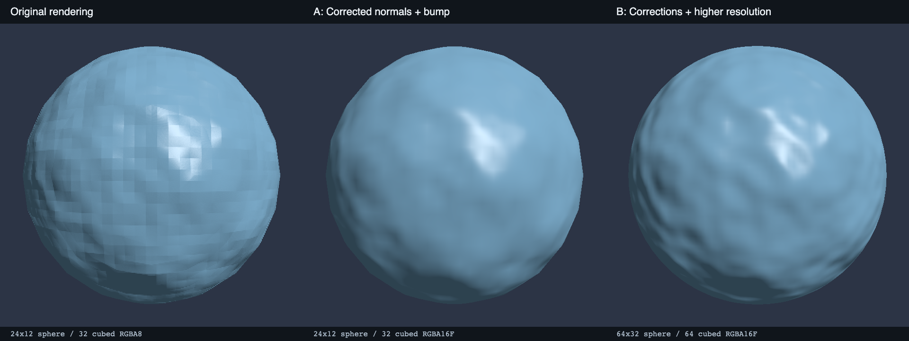

# Native surface-quality comparison — 25 October 2026



The original image shows triangular patches across the bump-lit surface. Correcting
sphere normals and sampling the bump gradient in object space removes those patches
at the original geometry resolution. Increasing geometry to 64 sectors / 32 stacks
and the material volume to 64 cubed also improves the silhouette and fine detail.
**64x32 geometry with a 64-cubed map is the suggested starting point for close-up
smooth spheres.** Keep smaller settings for distant objects; these are visual
recommendations for this fixture, not measured general-purpose quality thresholds.

| Native release variant | Triangles | Packed map | CPU bake/upload | Median captured frame |
| --- | ---: | ---: | ---: | ---: |
| Original, 24x12 / 32 cubed RGBA8 | 528 | 128 KiB | 3.218 ms | 0.971 ms |
| Corrected, 24x12 / 32 cubed RGBA16F | 528 | 256 KiB | 5.861 ms | 0.897 ms |
| Corrected, 64x32 / 64 cubed RGBA16F | 3,968 | 2 MiB | 21.714 ms | 0.867 ms |
| Corrected, 128x64 / 128 cubed RGBA16F | 16,128 | 16 MiB | 113.573 ms | 0.919 ms |

Apple M3 Pro, macOS Metal, Cargo release, 640x640 offscreen capture. Two warmups,
seven timed captures per variant; frame figures include blocking readback and CPU
work, **not GPU-only time or a game FPS guarantee**. Upload timing includes CPU
noise baking and resource creation, not a fenced measurement of completed GPU
upload. Single-run figures are illustrative; small frame-time differences are not
performance wins. Higher quality substantially raises bake time and memory.

Fixed settings: seed 42, 3D Perlin, domain extent 4, three octaves, smooth shading,
bump strength 0.15, map strength 1, shininess 64, linear albedo [0.22,0.45,0.65],
specular [0.55,0.55,0.55], camera [0,0,3], ambient 0.12 and directional intensity
0.85. Shadows are disabled to isolate the surface. Original standard/high log rows
vary geometry only: the old renderer always baked 32-cubed RGBA8 maps.

Individual captures: [original](before.png), [corrected same resolution](corrected.png),
[standard](standard.png), [high](high.png). Raw measurements: [before](before.log),
[after](after.log). These are actual native renderer pixels, not generated artwork.

Reproduce current captures from the repository root:

```sh
cargo run --release --features graphics --example surface_quality -- current /tmp/emergent-surface-quality
```

The original executable and source snapshot were preserved locally under
`/tmp/emergent-surface-quality/baseline-renderer` and `baseline-source` before edits;
those temporary files are not a durable reproduction environment. The original
captured pixels and measurements above are retained in this repository.

In the IDE select **Surface quality — low vs standard** and load it. Both objects
use the corrected renderer; the left uses 24x12 / 32 cubed and the right 64x32 / 64
cubed. Select either to edit Material → Map resolution. Existing authored object
settings remain unchanged. Reload inspection after updating the native renderer.

Validation: workspace tests, release/all-feature tests, strict Clippy and rustdoc;
IDE tests/lint/production build; native material, directional-shadow, point-shadow
smokes and authored comparison-scene capture. Windows/Linux rendering is unverified.
