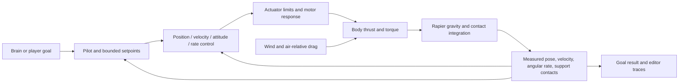

# Physics locomotion: drone fit/gap and delivery plan

Status: **implementation started**, 2026-11-02. Stage gates complete: **3 / 8**.
Scope: an opt-in drone that must generate thrust against gravity, fly to a point,
hold position against wind and land on collision geometry. Keep the current cheap
kinematic drone. FLIGHT-0/1/2 are delivered, including the loadable unpowered
physical boundary and its body/scene contracts. BehaviourTest is unchanged.
The full physics drone is not yet available in the editor.

Implementation evidence: [frozen contract](../design/flight-control.md),
[baseline](../benchmarks/flight-baseline.md), [checks](../platform/flight-control-macos.md).

## Recommendation

Use the existing Rapier integration for the first force-driven scene vehicle.
Add a reusable scalar PID mechanism and a drone pilot above it. The brain supplies
goals; the pilot converts measured error into bounded thrust and torque; physics
owns the pose. Start with a simple rigid body and aggregate rotor thrust/torque,
not a full aerodynamic model or a real flight-computer stack.

Natural motion comes from finite acceleration, thrust limits, attitude response,
inertia and disturbance rejection. A general collision solver is not required for
those effects in isolation. It is useful for believable landing, bumping objects,
slopes and external impulses. Emergent already owns that solver boundary, so a
second production rigid-body integrator would duplicate work.

This recommendation is a design judgement, not a measured performance result.
Keep a standalone force-integrated experiment available as a comparison at stage
FLIGHT-0; do not commit to shipping two new backends before there is evidence.

## Verified fit/gap

These observations started from the planning baseline; delivered boundary changes
are noted explicitly. Implemented locomotion models still write transforms and
reject dynamic bodies. The explicit `drone_physics` boundary requires a dynamic
body and never writes its pose; it is not a powered flight model.

| Need | Existing fit | Gap / required change |
| --- | --- | --- |
| Gravity, mass and collision | `src/physics.rs`: optional Rapier 0.36.1; dynamic bodies, box colliders and static terrain heightfields; gravity is currently world -Y at 9.81 m/s² with per-body scale | Define one gravity observation for controller feedforward; no competing drone gravity/mass fields. Physics remains authoritative |
| Sustained lift | `World::add_force` accumulates world-space newtons for the next fixed step, then clears them | Pilot submits body-up thrust every tick; zero thrust must produce free fall |
| Orientation control | `World::add_torque` and `World::angular_velocity` now expose validated per-tick torque and committed angular state; first-step, reset and stale-handle tests pass | Physical body observations, reconstruction revisions and reset handling are delivered; powered pilot and force-at-point remain pending |
| Current drone | `locomotion::advance`: proportional height-to-velocity request, response-limited acceleration, tilt-derived visuals and a flat floor | No weight, rotor lift, angular dynamics or aerodynamic wind response. Do not describe the current type as physical flight |
| Transform ownership | Scene loader rejects locomotion plus a dynamic body | Delivered mode-aware scene/runtime validation: only `drone_physics` accepts a dynamic body; legacy types retain their restriction. Conflicting motion/look writers and character drive are rejected |
| Character drive | `drive_body*` exists | Unsuitable for flight: ignores requested vertical velocity, locks rotation, and sets linear velocity. Do not route the drone through it |
| Intent and sequencing | `brain::Intent` carries velocity, advisory target, hover/brake/boost and world altitude; altitude can finish inside a positional tolerance | Add explicit flight goal semantics and measured result feedback. Position-radius completion alone does not mean settled or landed |
| Measured motion | Physics exposes linear velocity; brain snapshots estimate neighbour velocity | Legacy brain self velocity retains its existing command semantics. `drone_physics` now uses committed measured velocity for self/neighbour brain feedback and exposes copied physical observations; the powered pilot remains next |
| Look channel | Brain Look is applied by writing rotation after movement | Route a physics drone's look request into pilot heading. Direct Look/LookAt/Spin writes must not fight the body or bypass attitude control |
| Wind | Particle emitters have a `wind` acceleration parameter | No shared vehicle air-velocity field. Particle wind has different units/semantics; do not reuse it as m/s implicitly |
| Landing | Rapier solves contacts; current drone clamps centre to `ground_height` | No public flight-grade support-contact observation. Add post-physics support contact/normal data; do not infer landing from low vertical speed at an airborne apex |
| Ownership and timing | World-scoped typed `EntityId`, private backend handles, dense reused locomotion work list; brains → locomotion → physics in fixed ticks | Preserve this model and establish the first-step body observation, contact feedback latency and controller reset contracts |
| Authoring and previews | Rust catalogue, profile validation, `/locomotion`, Rust course preview, shared host and MCP behaviour tools | Add physical profile, controller inspection/traces, disturbance courses and physics-backed preview. Existing preview/profile formats need deliberate compatibility |

Source anchors: [locomotion](../../src/locomotion.rs),
[brains](../../src/brain.rs), [physics](../../src/physics.rs),
[World](../../src/world.rs), [fixed loop](../../src/engine.rs),
[scene validation](../../src/scene.rs),
[physics foundation](../design/physics-foundation.md).

## Options: what “without a physics engine” can mean

| Option | What is simulated | Benefits | Limits and use |
| --- | --- | --- | --- |
| Existing kinematic drone | Desired velocity, limited acceleration, prescribed pose and floor | Simple authored movement; retains current projects | No physical lift or contact response. Keep for decorative vehicles and workloads that justify it |
| Lightweight force-integrated drone | `a = gravity + (thrust + aerodynamic force)/mass`; fixed-step integration; bounded attitude/motor response | Can fall without power, lean into wind, overshoot and recover. Useful isolated flight or distant simulation | It is still a physics simulation. A flat floor cannot substitute for terrain/contact solving; angular inertia, impacts and constraints become our responsibility if expanded |
| Force-driven Rapier drone — recommended | Controller and motor model produce forces/torques; existing rigid body integrates them and solves contacts | Reuses engine collision, gravity, mass and scene ownership; supports landing and external disturbances | New controller/actuator integration and contact feedback required. Solver cost, controller stability and scale must be measured |

Do not switch backends automatically by distance in this slice. A later fidelity
transition needs explicit state transfer, contact and replay contracts. A simpler
motion model can look natural; visual judgement and contact requirements, not the
word “physics”, decide whether it is sufficient.

## Concise design brief

### Ownership and identity

- `World` owns canonical SlotMap entity identity and its private physics state.
  Rapier handles never enter assets, brain nodes, editor messages or public APIs.
- PID is a small value/state mechanism, with no independent object registry. Each
  vehicle owns its pilot mode, PID states, actuator state and current goal result
  in its engine component. Profiles contain configuration, never live integrals.
- Add one explicit catalogue type, provisionally `drone_physics` / “Drone (physics)”.
  `drone` retains its present meaning. The physical type requires `physics` and a
  dynamic body; feature-off loads fail clearly, with no kinematic fallback.
- Mass, gravity scale, collider and inertia belong to the physics body. Thrust,
  rotor response, tilt/rate limits and controller tuning belong to the locomotion
  profile. Initially derive inertia from the supported box collider; do not add
  duplicate mass/inertia settings for the pilot.
- A world resource owns the initial uniform wind velocity and deterministic gust
  schedule. No spatial volume graph is required for the first vehicle.
- Goal target entity references use the owning world's `EntityId`; durable assets
  resolve authored IDs at load. Missing/deleted targets fail the goal explicitly
  and enter position hold at the current measured pose; never resolve replacement
  objects through a stale handle.

### Data flow and one pose owner



Use the current fixed-tick order: read last committed physical state → evaluate
brain/goals → pilot/controller → queue force/torque → physics → publish measured
state and goal progress. Goal results are read on the next tick. Define first-tick
initial state explicitly; queued thrust must apply to a newly reconciled body in
that same step. Do not create an extra frame of startup free fall by accident.

Only physics writes the physical drone's transform and velocities. Controller,
brain look, inspector editing, parent motion, character drive and follow systems
must all respect that ownership. Keep existing supported dynamic-body hierarchy
restrictions. Validate unsupported moving parents and nonuniform scales rather
than applying approximate local rotations to physical bodies.

Reset controller history on scene reload, body reconstruction, explicit disarm,
teleport/reset and incompatible profile changes. Define re-enable and mode-change
state transfer to prevent a derivative spike or stale integral. Ordinary repeated
goal publication must not reset the controller each tick. Paused inspection does
not integrate the plant or PID and resuming does not accumulate wall-clock error.

### Goal-based pilot

Separate the mission decision from continuous stabilization. First goals are:
take off to world altitude, fly to a world-space point then hold, hold current
position, and land on supported ground. Goals persist until superseded or cancelled.
Use per-agent command revision/state to recognise goal changes; this is command
bookkeeping, not a new object identity system.

`Arrived` means inside position and speed tolerances for a dwell interval. The
pilot continues holding after arrival while the brain advances its mission.
An empty/completed brain must not implicitly turn motors off. Explicit disarm is
separate. A cancelled airborne goal defaults to measured-position hold; loss of
power disables lift and physics takes over. Report unreachable/saturated/failed
goals without pretending that the commanded position has been attained.

Keep current Seek/Arrive/steering behaviour through a velocity-command adapter for
the new type; do not silently reinterpret every existing advisory `Intent.target`
as “fly there and persistently hold”. Explicit flight goals have one movement
owner. Define precedence for altitude, velocity and heading requests before adding
new brain nodes. Initial nodes/authoring affordances should expose Take off,
Fly to and hold, Hold position and Land; the PID itself is not a mission tree node.

The recent altitude `finish_on_arrival` option remains a compatible positional
condition for existing brains. Physical flight adds settled-goal feedback rather
than silently changing every existing Sequence's completion semantics.

### Flight controller and actuator model

Start with cascaded control: position P → bounded velocity setpoint; velocity
PI/PID → desired acceleration; gravity feedforward and thrust/tilt allocation →
desired attitude and collective thrust; quaternion attitude P → bounded body-rate
setpoint; rate PID → body torque. Individual loops may use zero I or D; a general
PID primitive does not mean three nonzero terms everywhere. This architecture is
informed by [PX4's control diagrams](https://docs.px4.io/main/en/flight_stack/controller_diagrams),
not a proposal to embed PX4 or copy its frame conventions.

For Emergent's +Y-up world, the plant is:

```text
F_total = mass * gravity_vector + actual_body_up * actual_collective_thrust + F_air
F_air   = -drag_coefficient * (body_velocity - wind_velocity)   # initial linear drag
desired_lift_vector = mass * (desired_acceleration - gravity_vector)
```

Linear drag is the initial deliberate approximation; it couples wind to the body
without teleporting or adding wind velocity directly to its pose. Wind is m/s,
force is N, torque is N·m, mass is kg, lengths are m, rates are rad/s. A later
quadratic/orientation-dependent drag model requires its own calibration/evidence.
Use observed state without sensor noise initially; sensor fusion is out of scope.
The pilot need not know the wind to reject its effect through feedback.

A level 1 kg drone under 9.81 m/s² needs approximately 9.81 N of steady lift before
disturbances. Gravity feedforward supplies nominal weight compensation; integral
action corrects remaining steady error. At tilt angle θ, vertical lift is
`T*cos(θ)`: increasing horizontal authority consumes lift margin. Prioritise
vertical support, clamp feasible tilt/thrust/rates, and report saturation. A drone
with insufficient thrust must fail to climb, not receive hidden acceleration.

The first plant uses aggregate collective thrust and bounded body torque, with
finite motor response and a documented coupled authority envelope. Actual lift
acts along actual body-up, never instantaneously along the desired force vector.
Do not substitute visual banking for physical attitude response. Per-rotor force
allocation, force-at-point, rotor failures and battery sag follow only if required;
they are not needed to demonstrate gravity, control and wind compensation.

### Reusable PID requirements and reuse assessment

Delivered small `control` module: scalar configuration, scalar state and an
allocation-free fixed-step update; three axes compose three instances. It has no
entity awareness, global controller registry, scripting layer or tuning framework.

Required contract:

- Explicit positive finite `dt`, validated gains/limits and finite observations;
  unit-documented gains, predictable first sample and reset. Reject invalid config
  at authoring/load boundaries; invalid runtime state produces a defined fault.
- P, integrated I, and filtered derivative-on-measurement, with optional measured
  derivative input where available. D must not kick on a setpoint change.
- Output and integral limits, and anti-windup aware of downstream thrust/torque
  saturation. Internal scalar clipping alone cannot see actuator allocation limits.
- Feedforward supplied by the caller, not hidden in PID. Expose P/I/D contributions,
  requested/achieved output and saturation for traces. Define how achieved actuator
  output feeds integrator tracking, including the one-step motor-response delay.
- Reset/freeze/transfer rules for grounded/disarmed states and goal changes; do not
  integrate an impossible climb while motors are off. Gain changes during preview
  must have defined state handling rather than retaining incompatible history.

Reuse existing Rapier rather than another engine or vehicle framework. The focused
[`pid` 4.0.0 crate](https://docs.rs/pid/4.0.0/pid/) is a candidate, not selected or
installed. Its [source](https://docs.rs/pid/4.0.0/src/pid/lib.rs.html) provides bounded
terms and derivative-on-measurement, but uses per-call I/D gains without explicit
`dt` and lacks the required downstream allocation feedback/filter contract. It
would need adaptation. FLIGHT-1 selected the small engine-owned implementation
instead; no dependency was added. The exact API, filtering, tracking and reset
semantics are in the [implementation contract](../design/flight-control.md).

## Delivery stages and acceptance gates

Tally: **3 / 8 stages complete** (FLIGHT-0/1/2). FLIGHT-3 is next.
Unchecked gates remain planned; relative effort is not a calendar promise.

| Stage | Scope and dependencies | Required acceptance before advancing |
| --- | --- | --- |
| [x] FLIGHT-0 — baseline and contract | Delivered: public-API baseline runner, release measurements and frozen reference contract | Kinematic Stop route, free fall and first-step constant lift recorded; 60 Hz, synthetic actuator envelope, goal/contact/lifecycle rules and reference budgets selected. Optional second integrator deferred |
| [x] FLIGHT-1 — reusable PID | Delivered: `control::Pid`, validated immutable config, explicit time, filtering, caller feedforward, actuator tracking and telemetry; no new dependency | Ten physics-enabled tests include scalar reference cases, dt scaling, no D kick, bounded saturation/recovery, invalid-state rollback, zero allocated stepping/reset/error paths and real-body vertical lift/hold |
| [x] FLIGHT-2 — physical locomotion boundary | Delivered: boundary-only `drone_physics`, dynamic-body/feature/pose validation, committed state and reconstruction revisions, history resets, measured brain feedback and transient forces/torques | Seven authored-scene integration tests, reset-history unit test and feature-off tests cover unpowered fall, first-step lift/torque, reconstruction/removal, wrong-world/stale reads and conflicting writers. Browser verifies disabled boundary label; powered preview fails explicitly; six legacy types remain available |
| [ ] FLIGHT-3 — powered pilot | After FLIGHT-1/2; vertical control, attitude/rate stabilization, finite actuators, then 3D fly-to/hold. Large | Take off, settle, hold, fly to point and brake; measured feedback and persistent hold; bounded thrust/tilt/rate; no artificial pose/velocity writes; insufficient lift cannot reach goal; stable cancellation/re-enable and heading changes |
| [ ] FLIGHT-4 — disturbances | After FLIGHT-3; uniform wind, time-seeded gusts, air-relative drag and trace outputs. Medium | Same goal held in steady feasible crosswind; visible lean and extra thrust; recover after gust removal; unreachable wind shows saturation/failure without integral runaway; repeatable same-seed runs |
| [ ] FLIGHT-5 — mission outcomes and contact landing | After FLIGHT-3/4; settled feedback, brain node integration, support contacts, descent/touchdown/disarm states. Large | Takeoff → fly to point → hold → land sequence works; crossing target at speed does not complete; support contact plus low motion/dwell confirms landed; no apex/side-wall false landing, no gravity-floor clamp; deleted target and power loss handled explicitly |
| [ ] FLIGHT-6 — authoring and shared host | After FLIGHT-5; catalogue/profile inspector, PID tuning/plots, world wind controls, native/Rust preview and MCP/AI contracts. Medium–large | Create/save/reopen a physics drone with clear mass/collider requirements; select cloned profile without migrating existing assets; preview disturbance/landing uses same runtime; diagnostics, invalid input and dirty guards tested; standard template and independent game consume engine-host features |
| [ ] FLIGHT-7 — workload and release evidence | After FLIGHT-6; optimize only observed costs and run release validation. Medium | Meet agreed stability and workload gates below; engine format/tests/Clippy/rustdoc, IDE tests/build/browser smoke and native flight run recorded; feature-off compatibility; capability/status/goals updated only for delivered scope |

FLIGHT-1 and FLIGHT-2 have no runtime dependency on each other. Do not generalise
to cars, aircraft and boats before the first controlled drone passes these gates.
The scalar control module should remain reusable for those systems when required.
Record comparable native flight clips of the old and new drones on the same
course. Review tilt into wind, braking before the target, recovery and touchdown;
a mathematically stable but visibly twitchy controller does not meet the intended
authoring outcome. Natural appearance still requires sensible tuning.

## Proposed validation fixture and budgets

These are **reference implementation targets**, frozen at FLIGHT-0 in the linked
contract. They are not achieved full-flight claims or universal vehicle limits.

Reference drone: 1 kg box body, nominal gravity 9.81 m/s², max collective thrust
25 N, max tilt 35°, finite actuator response; stationary collision ground and a
clear flight area. One controller/plant step at 60 Hz initially. If stability
requires 120 Hz or bounded substeps, measure it and update the fixture/budget before
implementation continues; controllers and the plant must use consistent elapsed
time. Do not borrow real-flight gains without matching units, rate and inertia.

Acceptance route: take off to world y=5 m, settle, fly to `(10,5,0)`, hold, apply
wind/gusts, recover, descend onto a static landing surface, then disarm. Add a slope,
an obstacle side contact, failed lift and deliberate loss-of-power scenarios.

| Measure | Proposed gate |
| --- | --- |
| Nominal takeoff | Settle within 10 s; peak overshoot ≤0.5 m; height error ≤0.1 m and speed ≤0.1 m/s for 0.5 s before completion |
| Position hold / fly-to | Position error ≤0.2 m and speed ≤0.1 m/s for 0.5 s; continue hold for another 10 s without losing controller authority |
| Feasible disturbance | Initial drag coefficient 0.5 N per m/s; 3 m/s crosswind and an 8 m/s gust lasting 0.5 s; return to hold band within 5 s after the gust. Confirm actuator feasibility before using as a pass/fail case |
| Infeasible disturbance | Bounded output/integral, explicit cannot-maintain-goal status; no artificial force or target completion |
| Touchdown | Supported contact with suitable upward normal, low linear/angular motion for 0.5 s, then reduce lift/disarm; tolerate documented collider contact offsets; no false landed result during descent or at apex |
| Numerical integrity | No NaN/Inf; finite state after long saturation; repeatable on the same build/platform/seed. Cross-platform bitwise replay is not promised by current dependency configuration |

Profile optimized builds on a named reference machine (initially the available
Apple M3 Pro), identical scenes/seeds and 1, 16, 64, 128 and 256 drones. Measure
controller, force submission, physics and entire fixed tick separately, including
median/P95/P99/max, allocations and memory. Include clustered contacts, repeated
spawn/remove and mass/profile rebuilds; don't benchmark only separated hoverers.

Reference budget selected at FLIGHT-0: at 128 airborne drones, controller plus
actuation P99 ≤0.5 ms per 60 Hz tick, with zero steady allocations after warm-up;
physics plus control P99 ≤2 ms in the defined simple scene. These are local
engineering targets, not release promises. Report full frame pacing separately;
passing controller microbenchmarks does not establish game frame rate. If targets
fail, use profiles to choose a scale/fidelity limit rather than assert that Rapier
or a custom integrator is automatically faster.

## Change reach and compatibility checklist

- Engine: `src/locomotion.rs`, proposed `src/control.rs`, `src/brain.rs`,
  `src/physics.rs`, `src/world.rs`, `src/motion.rs`, `src/engine.rs`,
  `src/scene.rs`, `src/component.rs` and `src/lib.rs`; dependency/feature changes
  only if the reuse decision requires them.
- Validation: `tests/locomotion.rs`, `tests/brains.rs`, existing physics and
  scene/component/lifecycle tests, control unit tests, and targeted release
  workload benchmarks. Preserve stale-key, hierarchy and conflicting-writer gates.
- Shared host: `src/project_host/locomotion_tools.rs`, `brain_tools.rs`, inspection
  and native preview paths as required. Commands stay in the engine, not copied
  into BehaviourTest or `first_project`.
- IDE: locomotion types/assets/editor and trace parser; brain types/assets/editor;
  physics inspector, scene authoring/placement validation, MCP behaviour tools,
  project context/capabilities and related tests. Version trace extensions or retain
  old parser compatibility. Refresh catalogue caches when engine fields change.
- Fixtures/defaults: standard template build and an independently created project;
  opt-in sample flight/profile/ground with valid collision. BehaviourTest can be a
  later user acceptance scene, but this plan does not alter its current drone.
- Documentation: locomotion/physics/brain designs, this stage tally, live queue,
  implementation ledger and platform/performance evidence; update GOALS.MD and
  machine-readable capability status only when corresponding gates actually land.

Do not silently migrate existing profiles, reinterpret existing altitude arrival,
persist runtime handles, or mark physics flight available merely because a PID
helper compiles. No obstacle avoidance, path planning, CFD, sensor estimation,
battery model, rotor damage, auto-tuning or visual control-node framework in the
first slice. Straight-line fly-to must report its navigation limitation.

## Research references and verification boundary

Checked 2026-11-02:

- [PX4 control architecture](https://docs.px4.io/main/en/flight_stack/controller_diagrams):
  evidence for cascaded control, different loop types, derivative filtering and
  actuator saturation handling; reference design rather than a dependency.
- [Rapier force/torque guide](https://rapier.rs/docs/user_guides/rust/rigid_body_forces_and_impulses/):
  backend forces persist until cleared. Emergent deliberately resets/submits them
  per fixed step; the proposed torque path must preserve that engine contract.
  Verified torque/angular-state methods against the installed 0.36.1 Rust source,
  since online documentation may describe a newer release.
- [`pid` 4.0.0 source](https://docs.rs/pid/4.0.0/src/pid/lib.rs.html):
  reuse assessment only; nothing installed.

The original planning review did not validate physical flight. FLIGHT-0/1 now have
the implementation and headless evidence linked above; those checks still do not
validate a full 3D drone, contact landing, wind resource or editor workflow.
Engine/template workspace validation is now independent of ordinary game tests
through [PROJ-02](projects.md#project-isolation-proj-02); older game-scene failures
in historical evidence are not engine/flight acceptance gates.
